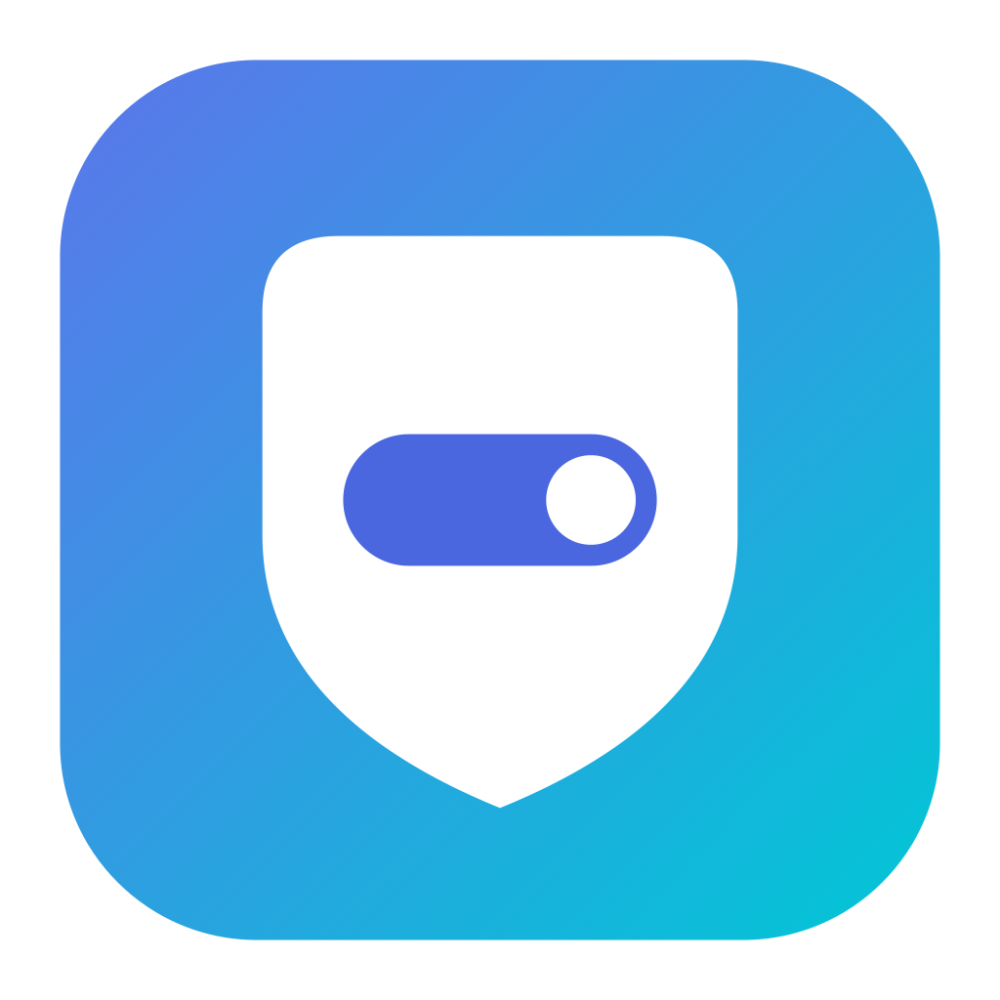
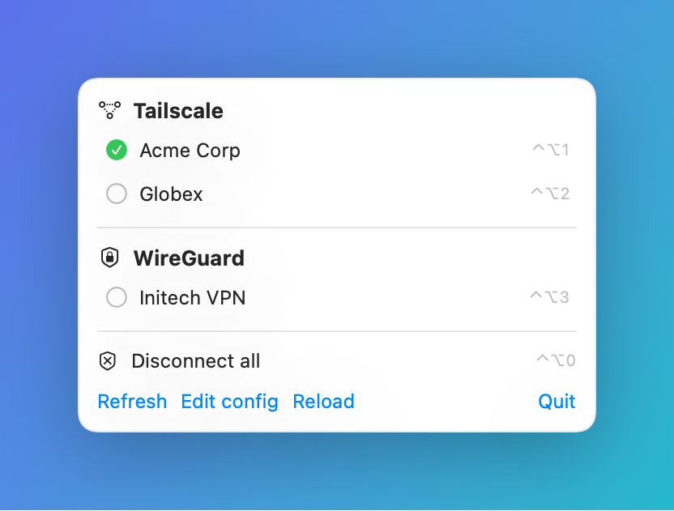
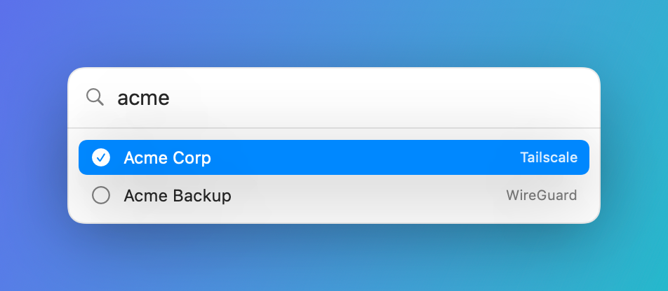

> 🌐 **English:** this document · **Español:** [README.es.md](README.es.md)

<p align="center">
  
</p>

# VPN Switcher

**One menu bar for every client's VPN** — Tailscale accounts, WireGuard
tunnels, native macOS VPNs, and anything else with a CLI.

If you juggle several clients' VPNs — a handful of Tailscale accounts, a few
WireGuard tunnels, a corporate IKEv2 or two — you end up app-hopping:
Tailscale's menu for tailnets, the WireGuard app for tunnels, System Settings
for the rest. VPN Switcher puts them all in **one menu bar**, grouped by
provider, one active at a time.

The trick is that it knows nothing about specific VPNs. Every profile is three
shell commands (activate / deactivate / status) in a declarative YAML file, so
it drives anything scriptable — Tailscale fast-switching, WireGuard via
`scutil`, native macOS VPNs, Mullvad, Cloudflare WARP, OpenVPN… Adding a client
is one block, not a new app. Global hotkeys and a Spotlight-style quick
switcher come on top.

## Screenshots

<p align="center">
  <br>
  <em>Profiles grouped by provider, ✓ on the active one, hotkeys on the right.</em>
</p>

<p align="center">
  <br>
  <em>The quick-switch panel (⌃⌥V): type to filter, ↑↓ to move, Enter to switch.</em>
</p>

<sub>Demo data — fictional companies, not real clients.</sub>

## Install

VPN Switcher builds from source. A local build is ad-hoc signed and carries no
quarantine flag, so it runs without Gatekeeper prompts — no "unidentified
developer" wall. One command:

```sh
git clone https://github.com/albegosu/vpn-switcher.git
cd vpn-switcher
./install.sh
```

`install.sh` checks for Xcode, installs [XcodeGen](https://github.com/yonaskolb/XcodeGen)
via Homebrew if needed, builds the app, installs it to `/Applications` (or
`~/Applications`) and launches it. Then click the menu bar shield →
**Create example config** and edit `~/.config/vpn-switcher/profiles.yaml`
(recipes in [PROVIDERS.md](PROVIDERS.md)).

**Requirements:** macOS 15+ and Xcode 16+. (XcodeGen is installed automatically
if you have [Homebrew](https://brew.sh).)

To update later, `git pull` and run `./install.sh` again. To uninstall, quit
from the menu and delete `VPNSwitcher.app` from `/Applications`; remove
`~/.config/vpn-switcher/` to drop your profiles.

## How it works

Everything is declarative. The app reads
`~/.config/vpn-switcher/profiles.yaml`; each profile declares a name, a
`provider` (only used to group profiles in the menu), and three commands:

```yaml
profiles:
  - name: Client A
    provider: tailscale
    activate_cmd: tailscale switch client-a.example.ts.net ; tailscale up --accept-routes
    deactivate_cmd: tailscale down
    status_cmd: s=$(tailscale status --json); echo "$s" | grep -q '"BackendState": "Running"' && echo "$s" | grep -A1 '"CurrentTailnet"' | grep -q '"Name": "client-a.example.ts.net"'

  - name: Client C
    provider: wireguard
    activate_cmd: scutil --nc start "client-c-tunnel"
    deactivate_cmd: scutil --nc stop "client-c-tunnel"
    status_cmd: scutil --nc status "client-c-tunnel" | head -1 | grep -qx Connected
```

Adding a new client means adding a block — no code changes. The full template
lives in [profiles.example.yaml](profiles.example.yaml) (the menu's "Create
example config" button writes the same one), and
**[PROVIDERS.md](PROVIDERS.md)** has ready-to-paste recipes for Tailscale,
WireGuard, native macOS VPNs (IKEv2/IPsec/L2TP), Mullvad, Cloudflare WARP and
OpenVPN.

- **`status_cmd` contract**: exit 0 = active, exit 1 = inactive, any other
  code = error (shown on the row). This is the natural convention of `grep -q`
  and `test`.
- **Real status, not your last click**: the app polls each `status_cmd` every
  `poll_interval` seconds (10 by default). Change a VPN from the terminal and
  the menu reflects it on the next poll.
- **Global exclusivity (one VPN at a time)**: activating a profile first runs
  the `deactivate_cmd` of **every** other active profile that declares one,
  regardless of provider. A profile without a `deactivate_cmd` is left alone.
  So bringing up a WireGuard tunnel drops the Tailscale tailnets and vice
  versa. (Switching between two tailnets then does a quick `down`+`up`; drop
  the `deactivate_cmd` if you prefer the mesh to coexist with WireGuard.)
- **Toggle**: activating a profile that is already active deactivates it (runs
  its `deactivate_cmd`), so re-selecting the active VPN disconnects it.
- Commands run through `/bin/sh -c` with the Homebrew paths prepended
  (`/opt/homebrew/bin:/usr/local/bin`), because an app launched from Finder
  does not inherit your shell's `PATH`.

## Global hotkeys & quick switcher

Also declarative. Each profile can declare a `hotkey:` that activates it from
anywhere, plus two top-level hotkeys:

```yaml
disconnect_all_hotkey: ctrl+opt+0   # take down every active VPN
quick_switch_hotkey: ctrl+opt+v     # open the quick switch panel

profiles:
  - name: Client A
    provider: tailscale
    hotkey: ctrl+opt+1
    ...
```

`quick_switch_hotkey` opens a **floating quick-switch panel** (Spotlight /
1Password Quick Access style): type to filter by name or provider, `↑`/`↓` to
move, `Enter` to activate the highlighted one (or deactivate it if it's
already active), `Esc` or a click outside to dismiss. The search field is
focused on open, so you can type immediately.

- Format: modifiers + key joined by `+`. Modifiers: `cmd`, `opt` (or `alt`),
  `ctrl`, `shift`. Key: a letter, a digit, `space`, or `f1`–`f12`. At least
  one non-shift modifier is required.
- Hotkeys appear in the menu next to each profile. If another program already
  owns a **global** hotkey, the system refuses the registration and the menu
  warns you — it is not stolen. Beware the opposite: a global hotkey that
  registers successfully **overrides that combo system-wide**, including local
  shortcuts in other apps (e.g. `cmd+shift+v` = paste-without-formatting in
  many editors). Pick combos you don't use — `ctrl+opt+<key>` is usually free.
- Built on `RegisterEventHotKey` (Carbon): no dependencies and no Accessibility
  permission, unlike global event monitors.

## WireGuard

**Recommended: the official WireGuard app (App Store).** Import the tunnel
there and let VPN Switcher drive it with `scutil --nc` — the headless
equivalent of the app's *Activate* button. It talks to the same Apple Network
Extension, so it needs **no `sudo`, no `wg-quick`, no `.conf` handling**, and
**does not run the tunnel's `PreUp`/`PostUp` hooks**. The name must match
`scutil --nc list` exactly. The same recipe drives **any native macOS VPN**
(IKEv2/IPsec/L2TP) from System Settings — see [PROVIDERS.md](PROVIDERS.md).

The raw `wg-quick` alternative (only if you can't use the app) needs a scoped
`NOPASSWD` sudoers rule and runs the tunnel's hooks as root, so review the
`.conf` first. On Apple Silicon `/opt/homebrew` is user-writable, so pointing
`NOPASSWD` at a Homebrew binary would let anything running as you escalate to
root; fully closing that means copying `wg-quick` **and** its dependencies
(`wg`, `wireguard-go`) into a root-only directory. The official app is simpler
and safer. Always keep the `.conf` root-owned (`chown root:wheel`, `chmod
600`) and out of any repo.

## Security

Threat model in short: the app is not a security boundary — it's a wrapper at
the same trust level as your user account. With the recommended setup
(Tailscale via CLI + WireGuard via the official app) **no command runs with
privileges**: everything runs as you. `sudo` only appears if you choose the
`wg-quick` alternative, and there it is the single privilege boundary (review
it yourself).

- **Client WireGuard private keys NEVER go in this repo.** With the official
  app they don't even pass through VPN Switcher (they live in the app's
  keychain). With `wg-quick`, the `.conf` stays root-owned outside the repo.
  `.gitignore` also blocks `profiles.yaml` and `*.conf` in case one lands here
  by mistake. The app reads no keys or credentials, makes no network calls of
  its own, and has no telemetry.
- **`profiles.yaml` is code, not data**: each profile is a command the app
  runs as you. The app creates it `600` (directory `700`) and **refuses to
  load it if other users can write it**. Whoever can write that file runs code
  as you — the same trust level as your `.zshrc`.
- **No sandbox, no hardened runtime, ad-hoc signed**: deliberate (the app runs
  external binaries); it's a personal utility with no distribution. Don't
  install third-party builds — compile it yourself with `make build`.

## Development

Requirements: macOS 15+, Xcode 16+, and
[XcodeGen](https://github.com/yonaskolb/XcodeGen) (`brew install xcodegen`).

```sh
make gen    # regenerate VPNSwitcher.xcodeproj from project.yml
make build  # build with xcodebuild
make run    # build and launch the .app
make test   # run the test suite
make typecheck  # quick type-check without Xcode (Command Line Tools only)
```

The `.xcodeproj` is not versioned: the project definition lives in
`project.yml`, so run `make gen` after cloning (the other targets do it for
you). See [CONTRIBUTING.md](CONTRIBUTING.md) for how to add a provider.

## Design notes

- SwiftUI `MenuBarExtra` (window style), Swift 6 with strict concurrency, one
  actor (`SwitchEngine`) that polls and executes, and an `@Observable`
  `AppState` on the MainActor as the single source of truth for the UI.
- **Zero package dependencies**: the YAML is parsed by a small purpose-built
  parser for the subset used here (`ProfilesConfigParser`, unit-tested).
- **No App Sandbox**: the app runs external binaries and reads `~/.config`.
- **A switch survives the menu closing**: activation runs in an actor `Task`,
  not the view's, so dismissing the menu mid-switch doesn't abort it.
- **Subset YAML parser**: scalar top-level keys + a `profiles:` list of flat
  maps, with comments and quotes. Unknown keys are ignored (forward
  compatibility). If full YAML is ever needed, only the parser changes.

## Status

- [x] Menu grouped by provider, read from `profiles.yaml`
- [x] Real-status polling with a ✓ on the active profile
- [x] Tailscale switching end-to-end
- [x] WireGuard / native macOS VPN via `scutil --nc`
- [x] Global exclusivity (one VPN at a time) and toggle
- [x] Global hotkeys + quick-switch panel
- [ ] Status-change notifications (a tunnel going up/down)
- [ ] Login item (start at login)
- [ ] Signed & notarized release for non-technical users

## Alternatives & prior art

VPN Switcher's niche is orchestrating **many different providers** from one
declarative config. If that's not your situation, one of these may fit better —
and they're worth knowing:

- **[vpn-bar](https://github.com/borzov/vpn-bar)**, **[vipinator](https://github.com/vpukhanov/vipinator)** (MIT, archived), and Timac's **VPNStatus/vpnutil** — native macOS menu bar togglers. Great if every VPN you use is configured in System Settings (IKEv2/IPsec/L2TP); they don't switch Tailscale accounts, drive WireGuard, or run custom commands.
- **[SwiftBar](https://github.com/swiftbar/SwiftBar) / [xbar](https://xbarapp.com)** — run any shell script in the menu bar. Same "a VPN is just commands" idea, but a blank canvas: you build the grouping, exclusivity and UI yourself. VPN Switcher is that idea, purpose-built.
- **[Shimo](https://www.shimovpn.com/)**, **[Viscosity](https://www.sparklabs.com/viscosity/)** — polished commercial multi-protocol clients. Paid and closed-source, protocol-based rather than command-based, and they allow simultaneous connections rather than one-at-a-time.
- **Tailscale**, **WireGuard**, **Mullvad**, **Proton**, etc. — each excellent for its own network. VPN Switcher doesn't replace them; it drives them from one place.
- **[TailMux](https://tailmux.app/)** (multiple tailnets *simultaneously*) and **[VPN-Bypass](https://github.com/GeiserX/VPN-Bypass)** (split-tunnel routing) solve adjacent, different problems.

What's unique here: heterogeneous providers via arbitrary commands, a
declarative config, cross-provider "one VPN at a time", and a quick-switch
panel — open source and dependency-free.

## Contributing

Recipes for new providers are especially welcome — see
[PROVIDERS.md](PROVIDERS.md) for the format. The config is declarative, so most
providers need only a tested recipe, not code.

## License

[MIT](LICENSE).
